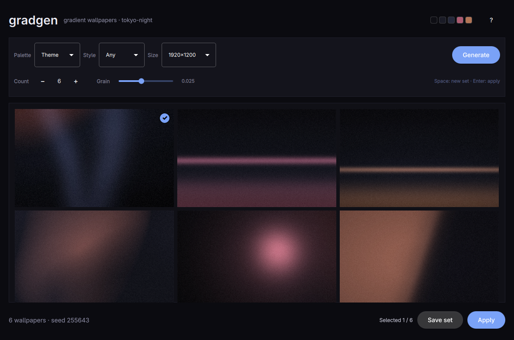

# gradgen



Gradient wallpapers from your desktop's own colours. Press Space for a fresh
set, arrow through the candidates, Enter to apply one.

It reads `~/.local/state/omarchy/current/theme/colors.toml`, so the wallpapers
match the theme you are running instead of a fixed palette. The heavy lifting
is the same Python renderer as `gradgen.py`: a base ramp, soft glows, optional
flow warp, vignette, and grain to stop banding.

## Build and run

```sh
bin/build
build/gradgen
```

`bin/test` builds and runs the backend tests offscreen. `bin/install` builds
the package with `makepkg -fsi` so it appears in the app launcher.

## Shortcuts

| Key | Action |
|-----|--------|
| Space | Generate a new set |
| Enter | Apply the selected wallpaper |
| S | Save the set to this theme's background folder |
| Arrows | Move between candidates |
| ? | Show the shortcuts |
| Q | Quit |

The selected candidate has an accent border and a check badge, the rest dim
slightly, and the footer shows `Selected n / total`. Double-clicking a
candidate applies it. The palette swatches in the header are the colours the
next set will use.

## Controls

- **Palette** — `Theme` keeps the theme's dark background shades but rotates
  through its accent families (blue, purple, cyan, red, yellow, green) on every
  generation. `Cool`, `Warm` and `Mono` are fixed families. `Custom` gives you
  four swatches — background, surface, accent A, accent B — and the set sweeps
  from A to B. Click a swatch to open the colour picker; the choice is saved.
  `Surprise` hands the palette to the renderer, so it can land outside the theme.
- The set sweeps from the first accent to the second, so the images vary within
  a family instead of being six copies. The header swatches show both ends.
- Accents are pulled toward the theme's lighter background on purpose. A
  wallpaper sits behind everything; full-strength accents glare and fight the
  bar. There is no soft toggle to get wrong.
- **Style** — `Any`, `Linear`, `Glow`, `Aurora`, `Mesh`, `Beam`, `Orb`, `Horizon`, or `Split`.
  Beam is shafts of light, Orb a single glow, Horizon a band on a vertical sky,
  Split a soft diagonal seam.
- **Size** — 11 presets covering 16:10, 16:9, 21:9, 32:9 and 3:2, from
  1920×1200 up to 5120×2880. The dropdown names the tier and aspect, e.g.
  `2560×1600 · 16:10` or `5120×1440 · 32:9`.
- **Count** — 3 to 12 candidates per set.
- **Grain** — film grain (0 to 0.06, default 0.01) that doubles as dither, so
  the ramps do not band. 0 is perfectly smooth and may show bands.

## What it writes

- **Apply** keeps a copy of the chosen image in
  `~/.local/share/gradgen/applied/` (the preview cache is wiped on the next
  generation) and runs `omarchy-theme-bg-set`, the same command the Omarchy
  menu and `omarchy theme bg next` use.
- **Save set** copies the candidates to
  `~/.config/omarchy/backgrounds/<theme-slug>/` and refreshes the background
  switcher thumbnails. Files are named
  `gradgen-<palette>-<style>-<seed>-<n>.webp`; the seed is what makes a set
  reproducible.
- Candidate images live in the cache
  (`~/.cache/gradgen/preview/`) and are replaced on every generation.

Nothing else on disk is touched, and the app never edits Omarchy's packaged
files.

## Renderer

`backend/gradgen.py` is the standalone generator, installed to
`/usr/share/gradgen/gradgen.py`. The app finds it there, or next to the build,
or through `GRADGEN_SCRIPT`. It needs Python 3 with `numpy` and `Pillow`; if the
system Python lacks them, the app retries through `uv run --with numpy --with
pillow` so a dev machine works without system packages.

Run the renderer by hand for anything the app does not cover:

```sh
python3 backend/gradgen.py -n 6 -s wuxga -f webp --style aurora \
  --palette "#1a1b26,#24283b,#7aa2f7" -o out

# One palette per image, cycled in order
python3 backend/gradgen.py --palette "#13141c,#1a1b26,#24283b,#7aa2f7;#13141c,#1a1b26,#24283b,#0db9d7"

# One generated family, hue shifted across the batch
python3 backend/gradgen.py --palette-seed 7 --palette-vary --soft --dim
```

`--palette-vary` works with `--palette-seed`, and `--dim` darkens a generated
palette for a wallpaper behind a dark desktop.

## Credits

The theme and translation plumbing follows Omarchy's app templates from
Omacut and Monologue (MIT, David Heinemeier Hansson). The renderer is the
original `gradgen.py`.
